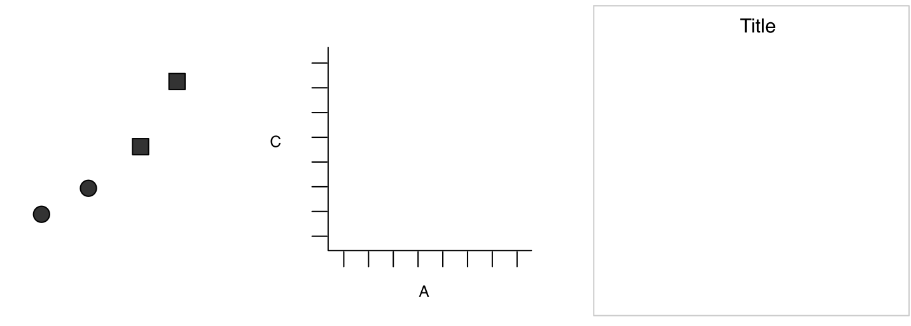
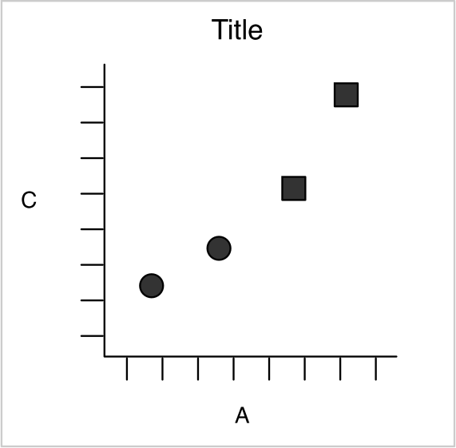

# Descriptive statistics and visualisation

{cite}`dds`, p. 41 shows schematically how we go about 'data science':

```{figure} images/ds-process-oneill.png
:width: 480px
:align: center
:name: ds-process

The "data science process". Figure after {cite}`dds`, p. 41 (Cathy O'Neil and Rachel Schutt, O'Reilly 2013).
```

Our focus here: exploratory data analysis

We will go over what we have learned about descriptive statistics so far and put it in a new context, summary statistics and visualisation in particular.


This revision doubles as a vocabulary lesson, because we want to understand the language of statistical data analysis and the language of machine learning alike, and to be able to translate between them.

## Statistics vs. machine learning

There are two "cultures": statistics with statistical learning, and machine learning with predictive modelling.
Machine learning is a subfield of artificial intelligence, statistics a subfield of mathematics.

* Corresponding terms, statistics – machine learning
  * model – model (where neural networks are used, also: the net)
  * parameters – weights
  * fitting – learning
  * performance on the test set – generalisation
  * regression, classification – supervised learning
  * density estimation, clustering – unsupervised learning
  * error function (loss function) – loss
  * estimating the parameters – training
  * sample – training data (training set); one pass through all the training data is called an epoch

The right-hand column is the vocabulary of the course "Introduction to Deep Learning", which works with it throughout; anyone who knows the left-hand column will find their way around there quickly.

*Exploratory data analysis* is the computing of summary statistics and visualisations (that is, of descriptive statistics) in order to get a better sense of the information in a dataset. It is a human-driven, iterative process and it needs knowledge of the field of application – without some idea of which values are plausible and which questions are worth asking, you produce diagrams instead of insights.
*Data mining* is about automating this step of a data science project: the automatic discovery of patterns and relationships, often following a scheme fixed in advance.

The various cultures of modelling can be broken down more finely still, as C. Molnar does in the book "Modeling Mindsets: The Many Cultures Of Learning From Data" {cite}`molnarmindsets`; for that, though, it helps to know the maximum likelihood approach and Bayes' theorem already.


## Descriptive statistics

Descriptive statistics consists of the data analyses that are made *before* inferential statistics. Mostly that means describing the data by various summary measures.

* A sample has a size = length = number of elements / rows / instances / outcomes (in Numpy that is the length of axis 0, see [Numpy](numpy.ipynb))

  To be distinguished from the sample is the *population*, the totality of all possible outcomes, with some distribution.

* With tabular data the columns are also called variables, attributes, characteristics or features, while the possible values are called *levels*.
  A dataset with $n$ rows and $k$ columns therefore has $n$ samples and $k$ features. Not every column is a feature in the statistical sense, though: a serial number, a student number or a primary key from a database only identifies the row and carries no information about what was measured – any analysis that treats an ID as a feature will find chance in it at best, and at worst the order in which the data was collected. The *target variable* you want to predict is a column too, but it does not count when you count the features.
  Depending on the kind of a feature, one distinguishes various *levels of measurement* (also called scale types); one says that a feature is measured on a nominal, an ordinal or a cardinal scale:
  * Nominal scale: categorical, discrete, no fixed order (e.g. sex, postcode, religious affiliation). Careful: mean and median make no sense here, frequencies do. The postcode is the classic case of "looks like a number, but is nominal" – a `mean()` over a column of postcodes gives you a number that means nothing.
  * Ordinal scale: values can be ordered, but with no measure of distance (e.g. rankings in sport, military ranks, the Mohs hardness of minerals). Careful: here too a mean makes no sense – Mohs hardness 5 does not lie "halfway" between 4 and 6, it is only harder than 4 and softer than 6.
  * Interval scale (a cardinal scale): (discrete or continuous) values can be ordered and distances between them can be given, but the zero point is fixed arbitrarily (e.g. temperature in degrees Celsius, dates, the water level of the Rhine, Likert scales such as "does not apply at all … applies fully"). Differences are meaningful, ratios are not: $20\,^\circ\text{C}$ is not "twice as warm" as $10\,^\circ\text{C}$.
  * Ratio scale: a cardinal scale with a natural zero point, so that the ratio of two values is a meaningful quantity (e.g. age, income, temperature in kelvin, speed in km/h, the number of people in a household). Here, for three values $a,b,c$, you may compare the ratios $a:b$ and $a:c$ with each other.

  Which summary measures and which arithmetic make sense for a feature hangs on its level of measurement – there is a summary below, in the section [Level of measurement and permissible summary measures](#skalenniveau-und-zulaessige-masszahlen).
* Univariate descriptions

  are summary measures that refer to a single variable, but not to how the variables relate to each other. These measures can be divided up further:
  * central tendency (one used to say 'averages')

    * The arithmetic mean (our estimate of the expected value of the underlying distribution)
    * The median (half the data points lie above the median, and in that sense it is the middle)
      Incidentally, it always holds that
      $|\texttt{median}(x) - \texttt{mean}(x)| \leq \sigma$
      On an ordinal scale (that is, when distances between the values cannot be given) the median is a meaningful quantity

    * The mid-range is the arithmetic mean of the maximum and the minimum.

    * The geometric mean

      is $\sqrt[n]{x_1 \cdots x_n}$, the $n$-th root of the product of the values (in Numpy `np.exp(np.mean(np.log(x)))`, in Scipy directly `scipy.stats.gmean`). It is the right mean when the values compound multiplicatively – for growth rates, say, the geometric mean of the yearly factors is the constant factor that leads to the same result after $n$ years. It presupposes a ratio scale, because it needs a natural zero point: the geometric mean of $10\,^\circ\text{C}$ and $20\,^\circ\text{C}$ is $\sqrt{200} \approx 14.14\,^\circ\text{C}$, but convert the same two temperatures to kelvin and $\sqrt{283.15 \cdot 293.15} \approx 288.11\,\text{K} \approx 14.96\,^\circ\text{C}$ comes out – two different answers to the same question. For negative values it is not defined at all.

    * The mode

      is defined as the most frequent value. The term itself is not very useful, but it is often used in the sense that a distribution is unimodal or bimodal. Unimodal means that there is one clearly recognisable mode which describes the distribution well. Bimodal means that the distribution is a mixture distribution whose two components have different modes. You then see that in two peaks. In general it is not clear whether a dataset should be regarded as unimodally or bimodally (or multimodally) distributed.

      For variables on a nominal scale the mode is a meaningful measure of location

    * To several of the measures of central tendency there belongs, in a sense, a measure of dispersion (see Dispersion), which you can remember as "dispersion precedes location". [The Wikipedia article 'Central tendency'](https://en.wikipedia.org/wiki/Central_tendency) is recommended on this.

  * Dispersion, spread

    Measures of spread characterise how far the data scatters around a measure of location, that is, how strongly it deviates from it. Since this also amounts to characterising how far each individual data point deviates from the others, measures of spread can be defined without direct reference to a measure of location.

    * Range: largest value minus smallest value
    * Variation ratio (also the *non-modal proportion*): the fraction of the sample whose value is not the mode
    * Quartiles: analogously to the median, the lower quartile $Q1$ is the value such that exactly a quarter of the data has a smaller value. The upper quartile $Q3$ is correspondingly the value such that exactly a quarter of the data has a larger value. The median is $Q2$. Percentiles are defined analogously. The difference $Q3 - Q1$ is called the **interquartile range** (IQR); it is the measure of spread that belongs to the median, and unlike the range it is insensitive to outliers – which is exactly why a boxplot draws the box from $Q1$ to $Q3$.
    * Sample variance: mean squared error about the mean
    * Sample standard deviation

      Once we calculate with units, we see a problem with the variance: if a random variable $X$ or a vector $x$ (a column of a table, say) is in metres (a ratio scale), then computing the variance forms a sum, or an integral, over squares, so the variance is in square metres. You can also see from this that the variance is scale-dependent in general, i.e. when comparing two variables, one in metres and the other in centimetres, the variance is no good comparison. Taking the square root corrects the first problem and yields, in the standard deviation, a measure in the same unit as the expected value.

      Careful: there are two formulas going by the name "sample standard deviation", one with $n$ in the denominator, one with $n-1$. This state of affairs is also called the *Bessel correction*, and we will come back to it as part of estimation theory. In these notes the $n$-version is meant unless something else is said (this is how `numpy.std` calculates too); pandas (`DataFrame.std`) and `scipy.stats`, by contrast, divide by $n-1$ by default (`ddof=1`).

    * Coefficient of variation

      The standard deviation has the same unit as the data, but it does not yet help when comparing two different features: is a spread of $3$ hours a lot? The **coefficient of variation** $\frac{\sigma}{\mu}$ is unitless and answers that question as a fraction of the mean (in Numpy `np.std(x)/np.mean(x)`, in Scipy `scipy.stats.variation`). It only makes sense on a ratio scale, because it depends on the zero point: computed in Celsius it can turn negative or infinite, in kelvin it cannot. Its reciprocal $\frac{\mu}{\sigma}$ is called the **signal-to-noise ratio** and is used in exactly the same way in engineering – the larger it is, the more clearly the signal stands out from the noise.

    * dispersion precedes location: to every measure of spread there belongs a measure of location, namely the value that minimises that measure of spread – depending on which norm you use to measure the error:

      * The mode minimises the variation ratio ($L_0$)
      * The median minimises the mean absolute error ($L_1$)
      * The mean minimises the mean squared error ($L_2$)
      * The mid-range minimises the maximum absolute deviation ($L_\infty$)

      The two middle statements are proved in the chapter [Expected value and variance](expectation-variance.md), section "Quantifying deviation".


  * Shape

    * Skewness is the third central moment, normalised by the standard deviation ($\mu_3 / \sigma^3$)
    * Kurtosis is the fourth central moment, normalised by the standard deviation ($\mu_4/\sigma^4$)
    * Excess kurtosis is the difference between the kurtosis and the kurtosis of a normal distribution – which, independently of the parameters, is exactly $3$

* Multivariate descriptions:
  * Correlations

    We will have to occupy ourselves with covariance and correlation soon. Covariance is to variance as an inner product is to a norm. The (Pearson) correlation coefficient is normalised so that it is scale-invariant.

[For a short and relaxed overview of part of the question "what actually are data", and of the question of scales in particular, there is a video from the HeiCAD programme "KI für Alle"](https://www.youtube.com/watch?v=hJVOudzjnEI) (in German).

(skalenniveau-und-zulaessige-masszahlen)=
### Level of measurement and permissible summary measures

The summary measures above do not make sense for every feature. A mean over postcodes is a number, but not information; a standard deviation over school grades presupposes that the distance between "good" and "very good" is the same as the distance between "sufficient" and "deficient". What is allowed is decided by the level of measurement:

| Level of measurement | Example | Meaningful comparisons | Measure of location | Measure of spread |
|---|---|---|---|---|
| nominal | degree programme, colour, postcode | equal / not equal | mode | variation ratio (non-modal proportion) |
| ordinal | school grade, Mohs hardness, rank | additionally: smaller / larger | median, quartiles | range, interquartile range |
| interval | temperature in °C, date, Likert scale | additionally: differences | arithmetic mean, mid-range | variance, standard deviation |
| ratio | age, price, temperature in K | additionally: quotients | additionally: geometric mean | additionally: coefficient of variation |

Every level of measurement also allows all the summary measures of the rows above it: for a cardinal feature you may give the median and the mode as well, for an ordinal one the mode. The other way round does not work – mean and variance of a nominal variable are meaningless, even when the levels are stored as numbers. A column of data type `int` is therefore a long way from being on a cardinal scale: an ID is nominal, a school grade ordinal.

**Two nominal features.** For the relationship between two nominal features there is no correlation coefficient, but there is an equally simple summary measure: the **cross-tabulation** (contingency table), which counts for every combination of levels how often it occurs. A cross-tabulation of ground truth against prediction is called a confusion matrix; the chapter [Titanic EDA](titanic-eda-numpy.ipynb) reads the quality of a classifier off one, and pandas produces it with `pd.crosstab`.

**Encoding categorical features.** Most machine learning methods (linear regression, say) calculate with numbers, and the question of how to translate a nominal or an ordinal feature into numbers hangs on the same table:

* An **ordinal** feature may be encoded as integers along its order ("low" $= 1$, "medium" $= 2$, "high" $= 3$; *integer* or *ordinal encoding*). The order is real; only the equal spacing is a modelling assumption, and one to keep an eye on.
* A **nominal** feature may *not* be: encode degree programmes as $1, 2, 3$ and you invent an order and distances that do not exist, and a linear model would calculate with them. Instead you give every level a column of its own, which is $1$ when that level is present and $0$ otherwise (*one-hot encoding*; the columns are also called *dummy variables*). A single column "degree programme" with three levels thus becomes three columns of zeros and ones.

How to do this with pandas, and what it means for a regression, is shown by the chapter [Linear regression](linear-regression.ipynb) on the Melbourne dataset. How to unify different spellings of a category beforehand is in the chapter [Data cleaning](data-cleaning.ipynb).

### A worked example

Take the $n = 8$ values $x = (7,\ 2,\ 9,\ 4,\ 4,\ 12,\ 5,\ 3)$ – the number of emails per day over a week plus a day, say.

* **Sorting**: $(2,\ 3,\ 4,\ 4,\ 5,\ 7,\ 9,\ 12)$.
* **Mode**: $4$, the only value that occurs more than once.
* **Median**: $n$ is even, so the mean of the two middle values $4$ and $5$: $\texttt{median}(x) = 4.5$.
* **Quartiles**: the lower half $(2,3,4,4)$ has median $Q_1 = 3.5$, the upper half $(5,7,9,12)$ has median $Q_3 = 8$; the interquartile range is $Q_3 - Q_1 = 4.5$. Careful: there are several conventions for quartiles. `numpy.percentile` interpolates linearly between the sorted values by default and gives $Q_1 = 3.75$ and $Q_3 = 7.5$ here.
* **Range**: $12 - 2 = 10$. **Mid-range**: $(12 + 2)/2 = 7$.
* **Mean**: $\texttt{mean}(x) = \frac{7+2+9+4+4+12+5+3}{8} = \frac{46}{8} = 5.75$.
* **Variance** ($n$-version): the deviations from the mean are $(1.25,\ -3.75,\ 3.25,\ -1.75,\ -1.75,\ 6.25,\ -0.75,\ -2.75)$, their squares $(1.5625,\ 14.0625,\ 10.5625,\ 3.0625,\ 3.0625,\ 39.0625,\ 0.5625,\ 7.5625)$ add up to $79.5$, so $\sigma^2 = 79.5 / 8 = 9.9375$.
* **Standard deviation**: $\sigma = \sqrt{9.9375} \approx 3.15$. With the Bessel correction: $\sqrt{79.5 / 7} \approx 3.37$.
* **Coefficient of variation**: $\sigma / \texttt{mean}(x) = 3.15 / 5.75 \approx 0.55$ – the spread amounts to a good half of the mean, so the days are very uneven. **Geometric mean**: $\sqrt[8]{7 \cdot 2 \cdot 9 \cdot 4 \cdot 4 \cdot 12 \cdot 5 \cdot 3} \approx 4.95$, smaller than the arithmetic mean $5.75$ (which is no accident: the geometric mean is never larger than the arithmetic one).
* Check: $|\texttt{median}(x) - \texttt{mean}(x)| = 1.25 \leq \sigma$. The mean lies above the median because the outlier $12$ pulls it up: the distribution is skewed to the right.

The same in Numpy (the quartiles with the linear interpolation of `numpy.percentile`):

```python
import numpy as np
x = np.array([7, 2, 9, 4, 4, 12, 5, 3])
print(np.median(x))            # 4.5
print(np.percentile(x, [25, 75]))  # [3.75 7.5 ]
print(np.mean(x), np.var(x))   # 5.75 9.9375
print(np.std(x))               # 3.1524... (n-version)
print(np.std(x, ddof=1))       # 3.3701... (Bessel correction, n-1)
print(np.std(x) / np.mean(x))  # 0.5482... coefficient of variation
print(np.exp(np.mean(np.log(x))))  # 4.9542... geometric mean
```

## Simpson's paradox

Before we come to the pictures, a warning about aggregating that needs nothing but percentages and still shows why data analysis is more than calculating. It comes from a medical study of two treatments for kidney stones {cite}`charig1986`; we will simply call the treatments A and B. Each was applied to 350 patients, and "success" is whatever the clinicians defined as success.

| Treatment | Patients | Successes | Success rate |
|---|---|---|---|
| A | 350 | 273 | 78% |
| B | 350 | 289 | 83% |

Imagine you have kidney stones. Which treatment do you choose? Most people say B.

But there are not simply kidney stones; there are small ones and large ones. Let us split the table along that line:

| Treatment | small stones | large stones |
|---|---|---|
| A | 81 of 87, so 93% | 192 of 263, so 73% |
| B | 234 of 270, so 87% | 55 of 80, so 69% |

For small stones A is better, for large stones A is better. If you have small stones you want A; if you have large stones you want A. Only if you do not know how large your stones are do you want B? That cannot be right, because your stones are either small or large.

The resolution is in the absolute numbers, not in the percentages. Treatment A was used almost only on large stones (263 of 350), treatment B almost only on small ones (270 of 350). Large stones are harder to treat, so the large group of difficult cases drags A's overall rate down, while B profits from the large group of easy ones. The doctors chose the therapy by stone size, and stone size determines success. A variable like this, which influences both which group you are in and the outcome, is called a **confounder**. The punchline: you should only choose B if it also lets you choose to have small stones.

This phenomenon is called **Simpson's paradox**: a relationship that holds overall can reverse in every single subgroup. It occurs not only in tables of percentages, but just as much with continuous features:

```{figure} images/simpson-paradox.png
:width: 560px
:align: center
:name: simpson-paradoxon

Simpson's paradox with continuous features: within each group $y$ rises with $x$, over all the points together the trend falls.
```

In the kidney stone example we knew the stone size. Often, though, the variable that creates the groups is not in the table at all: then we see only the cloud of points on the right, without the colours, and the falling trend looks entirely convincing. Such an unobserved variable is called a **latent variable**. There is nothing mysterious about the word, it only means "not observed". The overall distribution is then a **mixture** of two group distributions, and the question of whether a cloud of points can be decomposed into such groups meets us throughout this book: with the [contaminated normal distribution](important-continuous-distributions.ipynb), with [clustering by k-means](kmeans.ipynb), and finally with [Gaussian mixture models](expectation-maximization.ipynb). That covariance and correlation walk straight into this trap is something we see in the chapter [Covariance](covariance.md).

:::{admonition} Take-home message
Before you aggregate a table or read a trend off it, ask whether the data is secretly put together from several samples. If it is, calculate group by group. And check with the absolute numbers, not only with the percentages.
:::

:::{admonition} Exercise: Simpson in the Iris dataset
:class: tip
The Iris dataset (which we use often from the chapter [Iris](iris.ipynb) onwards) contains, among other things, sepal length and sepal width for 150 plants from three species. Determine the relationship between the two measurements once over all 150 plants and once per species. What do you observe?
:::

:::{admonition} Solution
:class: dropdown
Across all the plants the relationship is weakly negative (correlation coefficient about $-0.12$): wider sepals go together with shorter ones. Within each species it is clearly positive (setosa about $0.74$, versicolor $0.53$, virginica $0.46$). The species is the confounder: *setosa* has short, wide sepals, the other two long, narrow ones. Anyone who does not know the species sees a trend that holds in no group at all. How the numbers are computed is in the remark *For data* in the chapter [Covariance](covariance.md).
:::

## Visualisation

Why visualise? The first reason: summary numbers can lie without letting it show. [Alberto Cairo invented the 'Datasaurus'](http://www.thefunctionalart.com/2016/08/download-datasaurus-never-trust-summary.html) to point out the difference between summary statistics and visualisation:

> Never trust summary statistics alone; always visualize your data.
>
> Alberto Cairo, 2016

Justin Matejka and George Fitzmaurice developed the 'Datasaurus Dozen' out of it {cite}`matejka2017`, a series of twelve datasets that all have the same summary statistics (to two decimal places the same means and standard deviations of $x$ and $y$, and the same correlation coefficient of about $-0.06$ as well; what that measures comes in the chapter [Covariance and dependence](covariance.md)) but that look very different indeed.

```{figure} images/AllDinosGrey_1.png
:width: 480px
:align: center
:name: datasaurus-dozen

The Datasaurus Dozen, inspired by Anscombe's quartet. Figure: Justin Matejka and George Fitzmaurice, Autodesk Research 2017 {cite}`matejka2017`.
```

The second reason always to plot is Simpson's paradox from above: a single figure over all the data can say the opposite of what holds in every group, and in a plot you see the groups.

* The most important kinds of plot

  * Histograms

    To visualise the frequency distribution of features on a cardinal scale, you can put the feature on the x-axis and draw rectangles side by side whose area represents the frequency of a class, obtained by summing the frequencies over the underlying interval on the x-axis. The interval length is called the bucket size, bin size or class width. Choosing the right bin size is a science of its own, and there are various algorithms for computing a "good" bin size.

    Histograms are thus special bar charts / column charts. For features on a nominal scale you can look at the corresponding bar chart directly, which has rectangles of equal width with heights according to the frequency of a level. For that, an arbitrary ordering of the levels has to be chosen as well.

    The ordering is arbitrary only for *nominal* features, though; for an ordinal feature the $x$-axis should follow the order, otherwise you give away the information that is in it. If you want to show several groups in the same diagram, you stack the bars on top of each other (`plt.bar(..., bottom=...)`) – a *stacked bar chart*. That makes sense exactly when the sum of the groups means something in itself; otherwise bars placed side by side are easier to compare, because they all stand on the same baseline. A simple example with `plt.bar` is in the chapter [Titanic EDA](titanic-eda-numpy.ipynb).

    So a histogram really consists of a statistical transformation of continuous (cardinally scaled) data into discrete data, which is then bar-charted.

    Recommended: [the article "Histogram" on Wikipedia](https://en.wikipedia.org/wiki/Histogram), without code, and [the histogram examples in the Matplotlib documentation](https://matplotlib.org/stable/gallery/statistics/hist.html), with code

  * Scatter plot

    A set of vectors in $\mathbb{R}^2$ can be displayed by drawing a symbol at the coordinates, a filled circle for instance.
    With tabular data, two variables are typically picked out, one each for the x- and the y-axis.

    In Matplotlib that is one line, and if the data is already an $(N,2)$ array, it is the two columns:

    ```python
    plt.scatter(x, y, marker="o")
    plt.scatter(data[:, 0], data[:, 1])                  # the same for an (N,2) array
    plt.scatter(data[:, 0], data[:, 1], c=data[:, 2])    # third column as colour
    ```

    The third line is the trick by which a scatter plot accommodates a third variable: `c=` colours every point according to its value, and `cmap=` decides which colour scale is used for that. For a categorical feature with few levels this gives groups in different colours – that is how the Iris scatter plot in the chapter [Iris](iris.ipynb) is coloured (there with `cmap=plt.cm.cividis_r`), and in the chapter [Exploratory analysis: examples](eda-examples.ipynb) the colour carries the grape variety in the wine dataset.

  * Boxplot, also box-and-whiskers plot

    Shows median, quartiles and outliers of a distribution in one picture: the box runs from $Q_1$ to $Q_3$, the "whiskers" to the last value within $1.5$ interquartile ranges, and everything beyond that is drawn as an individual point. In Matplotlib `plt.boxplot(x)`; the chapter [Data cleaning](data-cleaning.ipynb) uses the same rule for outliers.

  * Line plot

    When you plot one or several graphs of functions (as we did with the PDFs), those are line plots. You can display data on cardinal scales with a line plot just as well, but connecting the points suggests a wealth of data that is not necessarily there.

    Conversely, the line plot is exactly the right tool when the data really does come from a curve: you sample points along the curve and connect them. A circle, for instance, comes about like this:

    ```python
    angle = np.linspace(0, 2 * np.pi, 360)
    plt.plot(np.cos(angle), np.sin(angle), linewidth=2)
    plt.axis("equal")    # otherwise the circle turns into an ellipse
    ```

    The same principle is behind every density plot in this book: the density function is evaluated at a few hundred points and the values are connected.

  * Pie chart

    As a rule: wherever a pie chart will do, a bar chart will do too, and it is easier to read. Pie charts therefore have their value above all when you want to lighten up a text without going into the statistic shown in any detail. Features on a nominal or an ordinal scale are in principle suited to them, since the pie shows the shares of the individual levels in a whole – it is a bar chart drawn in an unusual way.

  * Violin plot

    Similar to a boxplot, but in place of a rectangle the density is drawn in outline. A disadvantage is how rarely it is used, which leaves readers unaccustomed to this kind of plot.

  * Map plot

    With the image of a map (or another kind of map, e.g. a network topology) in the background, features can be displayed spatially, as the colour of a bounded area for instance. This is similar to a histogram, since instead of a scatter plot two-dimensional regions (rather than intervals) are aggregated before the aggregated data is displayed. A special case is a "map" consisting of a grid onto which frequencies are plotted, a two-dimensional histogram.

  * countless others, used more rarely or not classifiable in this scheme – what the most suitable means of communication is always depends on the case at hand.


* The most important tools for plotting with Python

  * `matplotlib` – this is what we use, it is the most widely used package for Python
  * The object-oriented interface of `matplotlib` – recommended by the developers
  * Seaborn – a layer on top of `matplotlib` that makes far-reaching assumptions about what might look good, with a focus on ease of use
  * Plotnine – an implementation of the grammar of graphics in Python, analogous to R's `ggplot2`
  * Bokeh – interactive web plots, e.g. the [demo on the IMDB dataset](https://demo.bokeh.org/movies)
  * Pygal – generates SVG files, which with HTML5 can also be used for animations.

* The grammar of graphics

  * History

    1983: Bertin: Semiology of Graphics

    2000: Wilkinson, Anand, Grossman: The Grammar of Graphics

    2005: Wickham: `ggplot2` R package

    2010: Wickham: A Layered Grammar of Graphics

  * Layers of the grammar

    * Data – which are to be visualised?
    * Aesthetics – axes, dimensions
    * Scales – scale the values? Nominal/ordinal?
    * Geometry – points, lines, polygons
    * Statistics – means, for example
    * Facets – subplots
    * Coordinate systems – Cartesian or polar or logarithmic

  * Combining the parts:

     $\to$ 

  * A layer consists of

    * Data and aesthetic mappings (aes)
    * Statistical transformations (stat)
    * Geometric objects (geom)
    * Position adjustments

  * A plot consists of

    * A default dataset and mappings of the variables in it to aesthetics
    * One or more layers (not necessarily with additional data)
    * One scale per aesthetic mapping
    * A coordinate system
    * A facet specification

  * A statistical transformation is typically a *summary* of data.

    Example: smoothing, which turns a set of points into a curve that is smooth (infinitely often differentiable).

    Some of the most important statistical transformations implemented in ggplot2 we have already met:

    * bin: divide a continuous range into bins (classes) and count the points in each class.
    * boxplot: compute the statistics for a boxplot
    * contour: compute contour lines
    * density: compute a one-dimensional density estimate
    * identity: the identity map, f (x) = x
    * jitter: change every value by a small random amount
    * smooth: smoothed mean of y given x
    * summary: summed values of y for each x
    * unique: remove duplicates

  * A scale in the sense of the grammar of graphics controls the mapping of data to the aesthetic attributes.

    Example: a real variable between $0$ and $1$ can be displayed as a change of colour from blue to red. The scale is the mapping of all values of $[0,1]$ to colour values. The inverse of this mapping can be used to draw a *legend*.

    Example: a factor variable (the species in the Iris dataset, say) is displayed with different symbols (in a scatter plot, say). The mapping from level to symbol is the scale.

    You can also map several variables onto one aesthetic, by mapping different values onto saturation and hue in the HSV colour model, for instance.

  * Colours

    When choosing colour scales you have to watch out for distinguishability, but also for the people who will look at the plots later. Two reasons never to use colour as the only distinguishing feature:

    First, the circumstances. A plot is looked at in sunlight on a laptop, projected through a badly calibrated beamer, or printed out – in the past regularly in greyscale. What remains is the lightness. A colour scale should therefore still work when you take the colour away from it, and curves are told apart additionally by line style (`linestyle="--"`, dotted, different line widths) or by markers (`marker="x"`, circles, triangles).

    Second, the viewers themselves. About one man in twelve and one woman in two hundred perceives colours differently from the majority, red and green most often of all. In a lecture with two hundred listeners there are therefore typically several people for whom a red-green scale is no scale. That is often enough to make it a habit and not an exception.

A colour palette that also works well with restricted colour perception is this one:


That it works can be checked by calculation: colour vision deficiencies can be simulated as a linear map in colour space, and applied to the eight colours above it looks like this.

```{figure} images/colour-vision-simulation.png
:width: 560px
:align: center
:name: color-friendly

The same palette, simulated for normal colour vision and for the three kinds of dichromacy (method after Viénot, Brettel and Mollon 1999). The colours stay distinguishable in all four panels – that is the property that matters.
```

Two things can be seen from it. First: the palette does lose its colourfulness, but no two patches fall together – every colour keeps a lightness of its own. Second: a palette that sets red against green would fall together here, and that is exactly what happens with the widespread traffic-light coding.

Research into well-suited colour palettes is not finished – at the SciPy conference in 2022, for instance, there was the talk [Development of Accessible, Aesthetically-Pleasing Color Sequences by Matthew Petroff](https://www.youtube.com/watch?v=Gapv8wR5DYU), whose [results went into Matplotlib version 3.10.0 in December 2024](https://matplotlib.org/stable/users/prev_whats_new/whats_new_3.10.0.html#new-more-accessible-color-cycle).


## Exploratory data analysis as a process

The tools of this chapter – levels of measurement, measures of location and spread, visualisation – are means to an end. The end is called *exploratory data analysis* (EDA): opening a dataset up step by step and being able to say something about it at the end. "Step by step" is to be taken literally here, and above all: in a circle. You go through the following five steps not once but again and again, because every pass throws up new questions.

1. **Formulate the research questions.** What do you actually want to know? What levels of measurement do the features have, what distributions do you expect, which relationships do you consider plausible? Without this step you produce diagrams instead of insights. In the chapter [Exploratory analysis: examples](eda-examples.ipynb) this step stands expressly at the beginning.
2. **Visualise the data.** The quickest way to see a distribution, an outlier or a relationship is a picture – that is the content of the previous section, and the Datasaurus has shown why summary numbers alone are not enough.
3. **Clean the data.** Check outliers and remove them where need be, impute or interpolate missing values, repair errors in the coding. In the chapter [Titanic EDA](titanic-eda-numpy.ipynb) missing ages are replaced by the median; the chapter [Data cleaning](data-cleaning.ipynb) makes a programme of its own out of that.
4. **Transform the data.** Select subsets, rescale features, build new features – age groups out of age (*binning*), say, or an area out of length and width. Such new columns are features as well, and finding them is often where the real insight is gained.
5. **Model the data.** Choose a statistical model and fit it to the data, a normal distribution or a regression line for instance. The chapters that follow are about that.

The five steps are the finer resolution of what {numref}`ds-process` shows as the whole picture at the start of the chapter. And because they run in a circle, it is also clear why EDA cannot be automated: step 1 needs somebody with a question, and step 3 somebody who knows which values are implausible in this field of application. We practise that in the chapters that follow, on several datasets.
